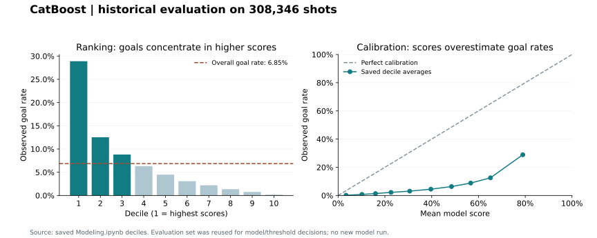

# NHL Shot Ranking: Finding Higher-Quality Scoring Chances

**An applied modeling case study using 1.03 million NHL shot records.** I compared five models, investigated target leakage, engineered contextual features, and tested class-imbalance strategies.

**Main finding:** in the saved CatBoost evaluation, the highest-ranked 30% of shots contained **73.3% of goals**, and the top decile had **4.21× lift** over the overall goal rate. This supports exploratory shot review. Scores are not yet calibrated expected-goals probabilities, and the evaluation set was reused during development.

[Model card and evidence](docs/MODEL_CARD.md) · [Validation priorities](docs/VALIDATION_PLAN.md) · [Reproduction guide](docs/REPRODUCIBILITY.md) · [Modeling notebook](Notebooks/Modeling.ipynb)

## Decision and potential use

A hockey analyst could prioritize higher-quality scoring chances for video review. Selecting the top 30% of this historical evaluation set includes 15,490 of its 21,137 goals, with a goal rate of 16.7% versus 6.85% overall. This is a retrospective workload scenario; no coaching impact, time savings, or deployment benefit has been measured.

## Data and approach

- **Data:** [MoneyPuck](https://moneypuck.com/data.htm) regular-season shot records, covering 2015–2024 according to the original project. The saved modeling path retains 1,027,818 records and 73 predictors before encoding. Records include missed shots, shots on goal, and goals.
- **Preparation:** investigated missing values, removed identifiers, vendor predictions and outcome-dependent fields, and engineered shooting/defending skater counts and team-relative penalty variables. Removing `shotwasongoal` after early modeling was an explicit leakage correction. The full cleaned-data handoff still needs reconstruction.
- **Experiments:** logistic regression, random forest, and XGBoost were compared using average precision (AP); XGBoost led that initial comparison with evaluation AP of 0.3611. Subsequent experiments compared sampling strategies and LightGBM, XGBoost, and CatBoost.
- **Evaluation:** stratified 70/30 random shot split, seed 12. Only training data were resampled; undersampling reduced training to 98,642 balanced records. CatBoost used native categorical inputs. Evaluation prevalence remained natural, but the set was reused for model and threshold decisions.

## Reported results

| Measure | Saved result | Interpretation |
|---|---:|---|
| CatBoost CV log loss | 0.516124 | Minimum saved CV mean on balanced training data |
| CatBoost evaluation log loss | 0.514662 | Natural-prevalence evaluation; lower is better |
| Top-decile lift | 4.214829× | Goal rate in highest-scored 10% / overall rate |
| Precision at top 30% | 16.75% | Selected shots that were goals |
| Recall at top 30% | 73.28% | All goals contained in selected shots |
| F1 at top 30% | 0.272613 | Historical precision/recall tradeoff |

The top-30% rule uses the **70th percentile of scores**, producing a cutoff of **0.526019**. It does not mean a probability threshold of 0.70 or a 70% scoring chance.

**Probability accuracy remains a gap.** The top decile's mean score was 0.790, but its observed goal rate was 0.289. A constant predictor using the saved training goal rate has evaluation log loss of approximately **0.249871**, calculated from saved aggregate counts—better than the model's reported loss. Calibration and fresh validation are needed before aggregating scores into expected goals.

## Highest-value next steps

1. Reserve later games/seasons for a fresh, game-separated evaluation.
2. Fit preprocessing, feature selection, and resampling within training folds.
3. Compare simple baselines and calibrate on natural-prevalence validation data.
4. Restore the missing cleaned-data transformation and remove cache-dependent execution.

These are planned improvements, not completed experiments. The [validation plan](docs/VALIDATION_PLAN.md) provides evidence and acceptance criteria.

## Explore the work

| Artifact | Purpose |
|---|---|
| [Cleaning](Notebooks/cleaning-moneypuck.ipynb) → [EDA](Notebooks/eda-mp_shots.ipynb) → [Modeling](Notebooks/Modeling.ipynb) | Historical workflow; data handoff gap documented |
| [Model card](docs/MODEL_CARD.md) | Scope, metric provenance, and interpretation limits |
| [Saved result exports](reports/) | Deciles, confusion matrix, comparisons, and source identifiers |
| [Reproduction guide](docs/REPRODUCIBILITY.md) | Rebuild supporting artifacts; understand training blockers |
| [Original metrics](metrics.csv), [report](Capstone_Final_Report.pdf), [slides](Capstone_Final_Presentation.pdf) | Unchanged historical materials |

Results are preserved from repository snapshot `1c0e229`; supporting calculations are labeled. No models were retrained. Credit for the source data and its supplied features belongs to MoneyPuck.

